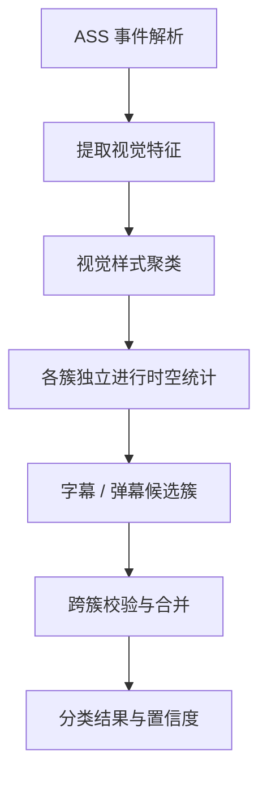

# 基于视觉样式聚类的字幕与弹幕识别

本文记录一种针对混合 ASS 文件的字幕与弹幕自动分类思路。目前仅作为算法构想，尚未实现。该算法考虑由独立的弹幕库实现，仅在此记录 idea。

## 基本假设

当字幕和弹幕出现在同一个文件或轨道中时，创作者通常会通过样式、位置或运动方式，使观众能够区分两类内容。

字幕一般具有较高的样式一致性，同一字幕轨道中的字体、字号、颜色、描边、对齐方式和显示位置通常比较稳定。弹幕的样式可能多样，也可能保持一致，但与字幕之间往往存在可观察的视觉差异。

这里的样式指最终呈现效果，包括 ASS Style 与事件覆盖标签共同决定的外观、位置和运动行为。不同事件即使引用同一个 Style，也可能具有不同的视觉表现。

该假设用于提供分类先验，不作为绝对约束。

## 算法流程

首先解析 ASS 样式表、事件属性及覆盖标签，提取每条事件的视觉特征：

- **外观特征**：字体、字号、颜色、透明度、描边、阴影等。
- **空间特征**：对齐方式、归一化位置、显示区域及位置稳定性。
- **运动特征**：静止、水平匀速滚动、其他运动及动画效果。
- **时间特征**：开始时间、持续时间、重叠关系及事件连续性。

根据外观和空间特征对事件进行聚类，形成若干视觉样式簇。同一簇中的事件不要求完全相同，但应具有较高的视觉相似性。运动特征可以辅助聚类，避免将外观相同的滚动弹幕和固定字幕直接合并。

随后对各样式簇独立计算时空统计特征，复用现有[字幕与弹幕自动分类](caption-classification.md)中的重叠率、突发密度、连续性、运动比例和垂直位置分布等指标。

字幕候选簇通常具有以下特征：

- 样式及显示区域长期稳定。
- 事件以连续、相对有序的方式出现。
- 同时显示的事件数量较少，允许双语字幕等合理重叠。
- 多数事件位于固定区域，尤其是画面底部。

弹幕候选簇则可能具有较高的时间密度、空间分散性和滚动运动比例。

最后结合各簇之间的视觉差异与时空证据，确定分类结果及置信度。必要时可以合并多个字幕簇，例如使用不同样式的双语字幕。

## 与现有分类器的关系

该算法主要解决同一 ASS 文件中字幕与弹幕混合时，整体统计容易受到相互干扰的问题。

已有的转换器来源识别、ASS 双向元数据恢复及高级表现识别仍然优先使用。视觉聚类主要用于缺乏可靠类型信息的事件。

高级表现属于独立的表现形式，特效字幕和高级弹幕均可能具有高级表现特征。识别时应保留相关事件的原始 ASS 指令，避免因重新分类而破坏动画或场景结构。

## 局限与后续实现

当字幕与弹幕的外观、位置和时间行为高度相似，且不存在可靠来源信息时，无法保证正确分类。特效字幕、歌词、弹幕艺术以及高度统一的固定弹幕也可能影响聚类结果。

样式聚类应结合整个事件群的统计特征，避免仅根据单条事件的样式差异进行分类。对于证据不足或不同特征相互冲突的情况，保留存疑类别，并允许用户手动指定。

本方案暂不确定具体的距离函数、聚类算法、特征权重及分类阈值，后续使用真实混合 ASS 样本验证。
